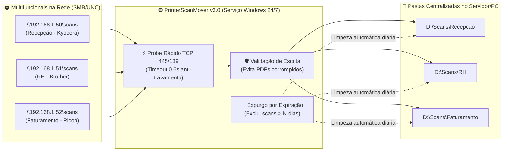

<div align="center">

# 🖨️ Printer Scan Mover (Mover SMB para Pasta do PC)

**Centralizador automático de digitalizações (Scan to SMB / UNC) de múltiplas impressoras em rede para Windows, com organização em pastas, validação de escrita e autolimpeza por prazo de expiração.**

[](https://github.com/Blastoles/Mover-SMB-para-Pasta-do-PC/releases/latest)
[](https://github.com/Blastoles/Mover-SMB-para-Pasta-do-PC/releases/latest/download/PrinterScanMover.exe)
[](https://www.python.org/)
[](https://www.microsoft.com/windows)

[📥 Download Direto (.exe)](#-download-direto-exe) •
[🎯 O Problema que Resolve](#-o-problema-que-resolve) •
[🏗️ Arquitetura de Funcionamento](#️-arquitetura-de-funcionamento) •
[🚀 Funcionalidades (v3.0)](#-funcionalidades-principais) •
[🌐 English Summary](#-english-summary)

</div>

---

## 🎯 O Problema que Resolve

Em ambientes corporativos, hospitais, escritórios e clínicas com **diversas impressoras e multifuncionais** (Ricoh, Kyocera, Brother, HP, Samsung, Canon, Epson), o envio de digitalizações via rede (**Scan to SMB / Pasta de Rede**) costuma gerar dores de cabeça para a equipe de TI e SysAdmins:

1. **Arquivos espalhados** em dezenas de compartilhamentos UNC (`\\IP_DA_IMPRESSORA\scans`) diferentes.
2. **Servidores e pastas lotados** com milhares de PDFs e imagens esquecidas pelos usuários.
3. **Lentidão e travamentos no Windows Explorer** (timeout de ~42 segundos do SMB quando uma impressora está desligada ou offline).
4. **Arquivos corrompidos** quando alguém tenta mover o PDF antes da multifuncional terminar a gravação via rede.
5. **Falha em servidores sem sessão logada**, quando utilitários comuns dependem de um usuário logado na área de trabalho.

O **Printer Scan Mover** resolve tudo isso em um único executável leve para Windows e Windows Server.

---

## 🏗️ Arquitetura de Funcionamento



---

## 📥 Download Direto (.exe)

Não é necessário instalar o Python para utilizar em produção:

1. 👉 **[Clique aqui para baixar o `PrinterScanMover.exe` (Última Versão)](https://github.com/Blastoles/Mover-SMB-para-Pasta-do-PC/releases/latest/download/PrinterScanMover.exe)** *(ou acesse a aba [Releases](https://github.com/Blastoles/Mover-SMB-para-Pasta-do-PC/releases))*.
2. Execute o arquivo diretamente no servidor ou computador Windows.

---

## 🚀 Funcionalidades Principais

### ⚡ Novidades da Arquitetura v3.0 (Enterprise Ready)
- **Execução no Boot sem Login (`--service`)**: Integração nativa com o **Agendador de Tarefas do Windows (Task Scheduler)**, garantindo que a coleta e limpeza funcionem 24/7 no servidor mesmo após reinicializações e sem usuário logado.
- **Probe Rápido SMB (Portas 445/139 em `0.6s`)**: Verifica via socket se a impressora está online antes de acessar o caminho UNC, eliminando o congelamento clássico de 42 segundos do Windows quando uma impressora está desligada.
- **Varredura Paralela Multithread**: Processa dezenas de impressoras simultaneamente com `ThreadPoolExecutor`, mantendo altíssima performance.
- **Compatibilidade Samba / Linux (`0x0`)**: Corrige atributos de arquivos gerados por firmwares Linux/Samba de multifuncionais e normaliza caminhos UNC raiz.
- **Instância Única Inteligente**: Abrir o atalho novamente foca e restaura a janela da instância que já está rodando em segundo plano.

### 🛡️ Gestão & Automação de Arquivos
- **Monitoramento de Múltiplas Impressoras**: Cadastre quantas regras de origem (`\\IP_DA_IMPRESSORA\scans`) e pastas de destino quiser.
- **Prazo de Expiração (Autolimpeza Automatizada)**: Configure em quantos dias os arquivos antigos da pasta de destino devem ser excluídos automaticamente (ex: apagar scans com mais de 7, 15 ou 30 dias).
- **Detecção de Estabilidade de Escrita**: Só move o documento após validar que o tamanho do arquivo estabilizou e que a impressora concluiu 100% da transmissão.
- **System Tray (Bandeja do Sistema) & Tema Escuro**: Interface moderna com logs em tempo real e execução silenciosa ao lado do relógio do Windows.

---

## 📁 Estrutura do Projeto

| Arquivo | Descrição |
|---------|-----------|
| [`main.py`](main.py) | Interface gráfica (GUI em modo escuro), gerenciamento da bandeja do sistema (System Tray), instância única e integração com inicialização/serviço do Windows. |
| [`monitor.py`](monitor.py) | Engine multithread de varredura de pastas SMB/UNC, probe TCP 445/139, validação de estabilidade de escrita, transferência e expurgo por prazo de expiração. |
| [`config.example.json`](config.example.json) | Exemplo de estrutura de configuração das regras de origem, destino, intervalo e dias de retenção. |
| [`build.bat`](build.bat) | Script automatizado para empacotamento do executável standalone com PyInstaller. |
| [`requirements.txt`](requirements.txt) | Dependências Python para execução em modo de desenvolvimento. |

---

## ⚙️ Como Usar

### Configurando uma Regra na Interface
1. Abra o **PrinterScanMover** e clique em **"Adicionar Regra"**.
2. **Nome**: Identifique a impressora ou setor (ex: `Recepção - Kyocera`, `RH - Brother`).
3. **Pasta de Origem**: Informe o caminho UNC de rede (ex: `\\192.168.1.50\scans`) ou diretório local.
4. **Pasta de Destino**: Escolha a pasta centralizada onde os usuários acessarão os arquivos.
5. **Intervalo de Checagem**: Tempo em segundos entre cada ciclo de leitura (padrão: `5s`).
6. **Autolimpeza (Dias de Expiração)**: Informe após quantos dias os arquivos antigos devem ser removidos automaticamente (`0` mantém para sempre).
7. Clique em **"Salvar Regra"** e ative o monitoramento em **"Iniciar Monitor"**.

---

## 💻 Execução via Código-Fonte (Desenvolvimento)

### Pré-requisitos
- Python 3.8 ou superior.
- Permissão de leitura/escrita nas pastas de origem e destino configuradas.

### Instalação
```bash
git clone https://github.com/Blastoles/Mover-SMB-para-Pasta-do-PC.git
cd Mover-SMB-para-Pasta-do-PC
pip install -r requirements.txt
python main.py
```

### Compilando o Executável (`.exe`)
Execute o script de build incluso no repositório:
```bat
build.bat
```

---

## 🌐 English Summary

**Printer Scan Mover (`Mover-SMB-para-Pasta-do-PC`)** is a lightweight Windows utility and background service built in Python for SysAdmins and IT teams. It automatically monitors multiple network printer SMB/UNC scan folders (`\\PRINTER_IP\scans`), verifies file write completion to prevent corrupted PDFs, moves scanned files into organized central directories, and automatically purges expired files after a configurable retention period (in days).

- **Fast TCP 445/139 Probe (`0.6s`)**: Prevents Windows SMB 42-second hangs when network printers are powered off.
- **Unattended Boot Execution (`--service`)**: Runs via Windows Task Scheduler without requiring an active user login session.
- **Multithreaded Engine**: Monitors dozens of multifunction printers (MFPs) concurrently.

---

<div align="center">

Desenvolvido por **[Igor Cezario Pereira (Blastoles)](https://github.com/Blastoles)**  
Se este utilitário ajudou sua infraestrutura de TI, deixe uma ⭐ no repositório!

</div>
